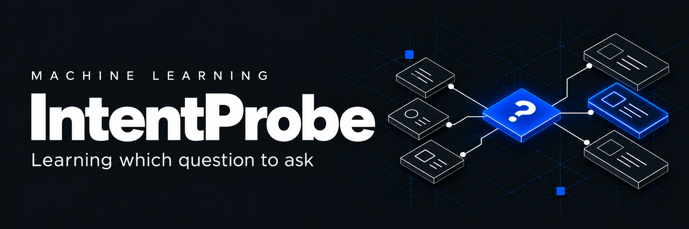
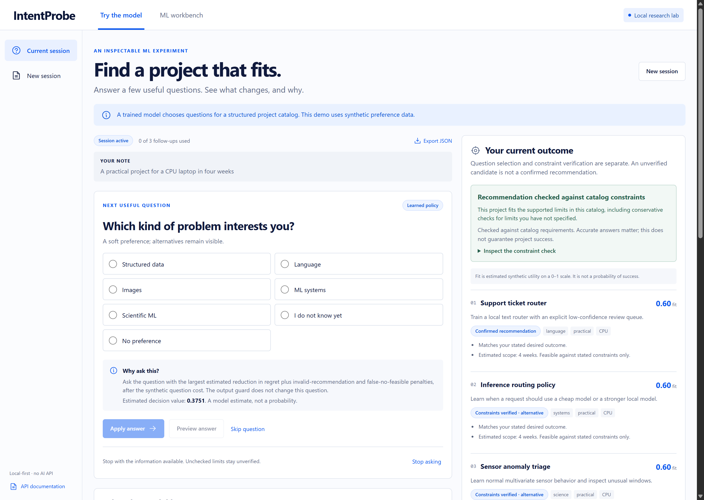

# IntentProbe

[](https://github.com/susmogus228/intent-probe/actions/workflows/ci.yml)

Learn which clarification question is worth asking before recommending a project.

IntentProbe trains a compact question-value model, serves it through a local API, and compares it with fixed, random, information-gain and analytic policies. You can try the model, change an answer and inspect the resulting recommendations. The ML workbench exposes the training data, model artifact and held-out benchmark.

**Evaluation scope:** controlled synthetic preference profiles and an authored catalog of project briefs. Benchmark scores do not establish usefulness for real users, and the project does not claim a new clarification algorithm. The current v2 release adds constraint-aware training and a separate constraint guard. See [research](docs/RESEARCH.md), [v2 model card](docs/MODEL_CARD_V2.md), [v2 data card](docs/DATA_CARD_V2.md) and the [simulation protocol](docs/SIMULATION-PROTOCOL-V2.md).

**Known limitation: no-feasible detection is 84.6% (22/26 cases), below the 95% target.** This measures detection of cases with no suitable project, not overall model accuracy. The result comes from a frozen synthetic audit of 40 profiles with two related answer variants each, at a budget of three questions. Four cases leave time unknown; the application keeps them unconfirmed instead of inventing an answer.



The workbench shows the actual artifact, split sizes and policy measurements. [Mobile interface](docs/images/v2/try-model-mobile.png) and [evaluation screen](docs/images/v2/evaluation-desktop.png) show the other entry points. After starting the local server, open the [interactive API documentation](http://127.0.0.1:8771/docs). See [screenshot notes](docs/images/README.md).

## Run locally

Requirements: Python 3.11 or newer, Node.js 22.12 or newer, npm. The checked dependency versions are in `requirements.lock` and `frontend/package-lock.json`. Use the same scikit-learn version that trained the bundled artifact.

Windows PowerShell, from this project folder:

```powershell
python -m venv .venv
.\.venv\Scripts\python.exe -m pip install -r requirements.lock
.\.venv\Scripts\python.exe -m pip install --no-deps -e .
Set-Location frontend
npm ci
npm run build
Set-Location ..
.\.venv\Scripts\python.exe -m uvicorn intentprobe.api:app --host 127.0.0.1 --port 8771
```

macOS/Linux, from this project folder:

```bash
python3 -m venv .venv
.venv/bin/python -m pip install -r requirements.lock
.venv/bin/python -m pip install --no-deps -e .
cd frontend
npm ci
npm run build
cd ..
.venv/bin/python -m uvicorn intentprobe.api:app --host 127.0.0.1 --port 8771
```

Open [the application](http://127.0.0.1:8771/) and [interactive API documentation](http://127.0.0.1:8771/docs). GitHub Pages cannot run this Python backend; users need a local Python server or a separately configured server deployment.

For frontend development, keep the API running and run `npm run dev` in `frontend/`. Vite proxies `/api` to port 8771. The production build uses same-origin requests.

## Try the model

1. Set your available time and any other known constraints. The optional context note is for your records; it does not change model features.
2. Start a session. The policy proposes a question and estimates its value under the synthetic preference model.
3. Select an answer to preview the resulting shortlist, then apply it. You can skip, stop, or revise an earlier answer.
4. Inspect feasibility reasons and alternatives. A fit score estimates synthetic utility; it is not a confidence or satisfaction probability.

Revising an earlier answer removes later answers and recalculates the session. The application does not invent what you would have answered on a different path. The constraint outcome distinguishes a verified catalog recommendation, no feasible brief and insufficient information. A skipped or unknown limit can leave the outcome unconfirmed even after questioning stops. Verification assumes accurate answers and catalog estimates.

The server saves sessions in `runtime/sessions.sqlite3`. You can reopen, export or delete them through the interface. Stored answers are recomputed using the currently loaded model; exports record that model version. Answers do not retrain the model. Restarting clears in-memory evaluation jobs but preserves sessions and the saved benchmark.

## Train and evaluate

Activate the Python environment, then run:

```bash
python -m intentprobe.ml.train_v2 --output artifacts/v2
```

The command preserves the original 300 training and 80 validation memberships, freezes the 40 previously unused vectors and selects one of two fixed configurations on validation only. It writes data, model, manifests and actual evaluation. The old 120 test vectors now serve as development diagnostics because they informed the redesign. Back up a bundle before replacing it, and restart the server after changing the model. Rerunning the same audit does not make it an unseen test again.

The server defaults to `artifacts/v2` and fails explicitly if it is unavailable. The preserved v1 bundle remains under `artifacts/`; set `INTENTPROBE_ARTIFACT_DIR` to that trusted directory only when deliberately choosing v1. The old training command remains available for v1 reproduction, but it overwrites that chosen output directory.

The workbench's **Run experiment** control re-evaluates the frozen model and test profiles. It does not tune or retrain the model. Repeated test runs do not create independent evidence or new participants.

The learned component estimates question value from observed state. V2 targets reductions in regret plus invalid-recommendation and false-no-feasible penalties, after question cost. The separate guard changes neither questions nor the selected candidate. Both components depend on the declared catalog and simulator.

## Measured quality and trade-offs

The frozen final audit has 40 preference vectors, each with two related answer variants. At budget three, on matched cases:

| Metric | v1 raw | v2 raw | v2 with guard |
|---|---:|---:|---:|
| Invalid recommendations / all cases | 26/80 (32.5%) | 7/80 (8.75%) | 0/80 |
| Invalid / issued recommendations | 26/78 | 7/58 | 0/48 |
| Valid recommendations / feasible cases | 52/54 | 51/54 | 48/54 (88.9%) |
| Detected no-feasible / no-feasible cases | 2/26 | 22/26 | 22/26 (84.6%) |

On the separate historical diagnostic cohort, violations fell from 22.5% to 2.5%. Those development results are not an independent test. The 95% no-feasible detection target was missed on the final audit; four cases left time unknown.

Zero observed guarded errors does not certify a population risk below 5%. Forty vectors are a small sample, the guard relies on truthful answers, and the learned model has not beaten the analytic baseline. Preference regret on matched final cases increased from 0.10370 in v1 to 0.15741 in v2 raw while the constraint-aware objective improved. Several modeling choices changed together, so this is a release comparison rather than a loss-function ablation. The [model card](docs/MODEL_CARD_V2.md) reports denominators, uncertainty, targets and adversarial stress results.

## Checks

From the project root, create the ignored scratch directory before using a nested pytest temporary path. On macOS/Linux, use `mkdir -p work`.

```powershell
New-Item -ItemType Directory -Force work | Out-Null
.\.venv\Scripts\python.exe -m pytest -q --basetemp=work/pytest-check
Set-Location frontend
npm run typecheck
npm run build
```

The Python tests cover constraints, feature isolation, grouped splits, model integrity, guard semantics, answer revision, stale writes, hypothetical outcomes and API errors. The checked Windows v2 run passed 63 tests. Browser evidence and remaining limitations are recorded in [verification](docs/VERIFICATION.md).

## API example

```bash
curl -X POST http://127.0.0.1:8771/api/sessions \
  -H "Content-Type: application/json" \
  -d '{"initial_request":"A practical ML project","budget":3,"policy":"learned","facts":{"time":"month"}}'
```

Fetch `GET /api/meta` for valid question IDs and answer values. Mutations require the session's current `expected_revision`; the server rejects a stale revision with HTTP 409. See [the API contract](docs/API-CONTRACT.md) and `/docs` for request/response schemas.

## Project layout

```text
intentprobe/ml/        Catalog, synthetic profiles, learned policy, training and evaluation
intentprobe/api.py     HTTP endpoints, model lifecycle and evaluation jobs
intentprobe/store.py   Transactional local session storage
frontend/             React and TypeScript application
artifacts/            Preserved v1 bundle
artifacts/v2/         Current trusted model, frozen protocol, data and audit
tests/                Domain, ML, storage and API regression checks
docs/                 Research, protocol, cards, requirements and verification
runtime/              Private local sessions, ignored by Git
```

## Boundaries

The application runs on localhost and has no multi-user authentication. Do not expose the development server directly to the public internet. It sends no requests to an external model API and needs no inference key. Only load trusted, locally generated model bundles: joblib uses pickle, and a matching SHA-256 detects changes rather than authenticating the author.

The catalog contains scoped project ideas, not a list of projects already implemented by the author. Results from the synthetic simulator do not establish human preference quality, free-form language understanding or superiority to a general-purpose AI assistant. A real-user study and a controlled LLM comparison have not been run.
